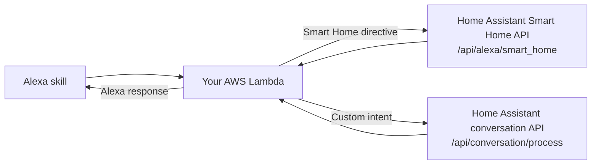

# Halexia

A self-deployed Alexa skill bridge for Home Assistant. Smart Home directives go to Home Assistant's Smart Home API; Custom requests go to its conversation API and are answered by the selected conversation agent. Halexia does not translate prompts, turn Custom requests into device commands, or provide an arbitrary Alexa fallback for Smart Home.

**Self-hosted** · **Alexa Smart Home + Custom** · **Home Assistant** · **Python 3.12**

[](LICENSE)

[](interaction_models/)
[](https://github.com/andreacasarin/Halexia/actions/workflows/ci.yml)

Each user creates and operates their own AWS Lambda function and Alexa skill, linked to their own Home Assistant instance. This repository provides source code for self-deployment, not a shared Alexa skill.

## Request flow



Smart Home handles ordinary device controls directly. Custom requests go to the selected Home Assistant conversation agent, which may use AI; the bridge does not require or provide an AI model.

## Voice models

English is the original/default model. Italian is its translation. Both models use the same `AskHomeIntent` and a `query` slot.

| Language | Locale | Invocation | Request phrases |
| --- | --- | --- | --- |
| English (original/default) | `en-GB` | `home assistant` | `ask {query}`, `question {query}` |
| Italian (translation) | `it-IT` | `assistente casa` | `chiedi {query}`, `domanda {query}` |

### Example

English: say **“Alexa, open home assistant.”** After Alexa responds, say **“ask what time is it.”**

Italian translation: say **“Alexa, apri assistente casa.”** After Alexa responds, say **“chiedi che ora è.”**

## Get the source

When the GitHub repository is public, clone it over HTTPS:

```sh
git clone https://github.com/andreacasarin/Halexia.git
cd Halexia
```

Or select **Code → Download ZIP** on the GitHub repository page and extract the archive.

## Build and deploy

From the checkout root, create the Lambda runtime package:

```sh
python3 package.py --runtime-only
```

This creates `dist/halexia.zip`. In AWS Lambda, choose Python 3.12, upload that ZIP, and set the handler to `alexa_bridge.lambda_function.lambda_handler`. The handler uses only Python's standard library. The runtime ZIP contains `alexa_bridge/lambda_function.py` and the bundled `alexa_bridge/LICENSE`. If you also need a source export, `python3 package.py` creates `dist/halexia-source.zip` alongside the runtime package.

The Lambda timeout should be at least 8 seconds (AWS defaults to 3 seconds; see [AWS timeout settings](https://docs.aws.amazon.com/lambda/latest/dg/configuration-timeout.html)). A longer Lambda timeout does not extend Alexa's roughly 8-second response window ([Alexa Smart Home guidance](https://developer.amazon.com/en-US/blogs/alexa/device-makers/2024/08/common-alexa-smart-home-errors); [progressive response reference](https://developer.amazon.com/en-US/docs/alexa/custom-skills/progressive-response-api-reference.html)). The bridge caps its Home Assistant HTTP call at 6 seconds and by remaining Lambda time minus about one second; these are not end-to-end deadlines. Measure complete requests in your deployment.

You can also paste the unchanged `lambda_function.py` from the source checkout into the Lambda code editor and use the handler `lambda_function.lambda_handler`. Save and deploy after changing code or environment.

### Lambda settings

| Variable | Required | Purpose |
| --- | --- | --- |
| `BASE_URL` | Yes | HTTPS Home Assistant base URL, with no path, query, or fragment. Shared by both models. |
| `AGENT_ID` | For Custom | Conversation entity ID for the agent to use. |

Alexa and Lambda need trusted HTTPS access to the Home Assistant host on port 443. The bridge always sends `AGENT_ID`; Home Assistant's REST `conversation.process` API uses its built-in agent only when `agent_id` is omitted. It does not automatically select the preferred Assist pipeline, which uses a WebSocket conversation flow this bridge does not implement.

### Lambda diagnostics

Set `DEBUG=1` to enable sanitized Custom failure warnings. Any non-empty value enables them, including `DEBUG=0`; remove the variable or leave it empty to disable diagnostics. Warnings include only fixed categories and numeric HTTP status or configuration key names. They do not include requests, responses, URLs, headers, questions, speech, tokens, or exception details.

## CI and releases

GitHub Actions runs the test suite and builds the Lambda ZIP for pushes and pull requests to `main`. Successful runs upload `halexia.zip` as a workflow artifact for 14 days. Download it from the run’s **Artifacts** section; it is the Lambda ZIP itself, with no outer archive to extract. [View workflow runs](https://github.com/andreacasarin/Halexia/actions/workflows/ci.yml).

When a `v*` version tag is pushed, the release workflow tests and builds that tag and publishes `halexia.zip` as a GitHub Release asset. Download versioned packages from [GitHub Releases](https://github.com/andreacasarin/Halexia/releases). A release provides the Lambda ZIP; it does not deploy it to AWS.

## Configure the Alexa skill

1. Use one Alexa Smart Home skill. Configure its Smart Home model for `it-IT` and `en-GB`. Under **MODELS**, add a Custom model for each locale, import the matching JSON files from `interaction_models/`, and build both models.
2. Set the same Lambda ARN as the Smart Home and Custom endpoint.
3. Enable both the **Alexa Smart Home** and **Alexa Skills Kit** Lambda triggers, each restricted to the same skill ID.

### Home Assistant account linking

For an existing Smart Home deployment, keep its Home Assistant configuration, OAuth account link, and `smart_home` scope. Keep `BASE_URL`, add `AGENT_ID` for Custom conversation, set the Custom endpoint to the same Lambda, and add the Alexa Skills Kit trigger. Do not change the existing Smart Home link to the Custom `intent` scope or relink unless the link is invalid or its settings changed. Remove any old shared `HA_TOKEN` Lambda variable; the bridge uses the token supplied through Alexa account linking.

For a new Custom model that needs account linking, configure **Auth Code Grant**:

| Setting | Value |
| --- | --- |
| Authorization URI | `https://your-home-assistant.example/auth/authorize` |
| Access Token URI | `https://your-home-assistant.example/auth/token` |
| Client ID (EU) | `https://layla.amazon.com/` |
| Client ID (US) | `https://pitangui.amazon.com/` |
| Client ID (Japan/Australia) | `https://alexa.amazon.co.jp/` |
| Client Secret | Any non-empty value; Home Assistant ignores it. |
| Client authentication | Credentials in request body, not HTTP Basic. |
| Scope | `intent` |

Keep the trailing slash on the Client ID and choose the value for your Alexa region. Leave the domain list and default access-token expiration blank. Turn off **Allow users to enable skill without account linking**. Home Assistant currently does not enforce the `intent` scope for Custom conversation. If prompted about PKCE, follow compatibility instructions for your installed Home Assistant version. The authorization and token URLs must use the same trusted HTTPS Home Assistant host.

## Operation and troubleshooting

Smart Home directives are forwarded unchanged to `<BASE_URL>/api/alexa/smart_home`. The bearer token is read from Alexa's `endpoint.scope`, `payload.grantee`, or `payload.scope` field when present. Custom requests go to `<BASE_URL>/api/conversation/process` with the Alexa locale, `AGENT_ID`, and conversation context. Home Assistant's Smart Home integration and conversation agent are separate controls.

The spoken Custom connection error is generic and may occur before the HTTP timeout expires. To investigate, set `DEBUG=1`, save the Lambda setting, deploy the current package, and ask a read-only question. Check the latest invocation in **CloudWatch → Log groups → `/aws/lambda/<function-name>`** for a `custom_failure` line.

| Log category | What to check |
| --- | --- |
| `missing_config` | Add the named `BASE_URL` or `AGENT_ID` variable. |
| `invalid_base_url` | Use a plain HTTPS base URL without path, query, or fragment. |
| `http_error`, status `401` | Relink the Alexa account. |
| `http_error`, status `403` | Home Assistant denied permission. |
| `http_error`, status `400` | Check `AGENT_ID` and Home Assistant; the status alone does not identify the cause. |
| `timeout`, `tls_error`, `connection_error` | Check request duration, Home Assistant availability, certificate validity, and Lambda network access. |
| `invalid_json` | Home Assistant returned invalid JSON. |
| `unusable_speech` | Check the selected agent and Home Assistant response. |

The bridge does not retry. A timeout or connection failure may occur after Home Assistant received a request, so check Home Assistant before repeating a command that may have changed device state. Remove or unset `DEBUG` after troubleshooting. Share only the sanitized `custom_failure` line when asking for help; never enable full-event logging.

## Verification

Run the local test suite from the checkout root:

```sh
python3 -m unittest discover -s . -p 'test_*.py'
```

One Italian read-only conversation round trip has been manually confirmed in the current setup. This does not verify the English model, other locales, Smart Home actions, Home Assistant outage behavior, or physical controls.

## License

Halexia is licensed under Apache License 2.0; see [LICENSE](LICENSE).

## References

- [Home Assistant REST conversation API: send a sentence](https://contributors.home-assistant.io/core/internals/conversation-api/#send-a-sentence)
- [Home Assistant Assist pipelines: run a pipeline](https://contributors.home-assistant.io/core/internals/assist-pipelines/#run-a-pipeline)
- [Home Assistant Alexa intent account linking](https://www.home-assistant.io/integrations/alexa.intent/#account-linking)
- [Alexa Smart Home MCS developer console](https://developer.amazon.com/en-US/docs/alexa/smarthome/mcs-dev-console.html)
- [Alexa Smart Home MCS FAQ](https://developer.amazon.com/en-GB/docs/alexa/smarthome/mcs-faq.html)
- [Alexa account linking for Custom skills](https://developer.amazon.com/en-US/docs/alexa/account-linking/add-account-linking-logic-custom-skill.html)
