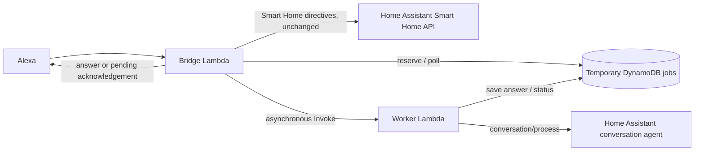

# Halexia

A self-deployed Alexa Smart Home and Custom skill bridge for Home Assistant, using Python 3.12. Alexa handles both speech recognition and speech synthesis. No Piper, Whisper, audio streaming, Home Assistant changes, or inference-stack changes are needed.

Each operator deploys their own AWS resources and links their own Home Assistant account. This repository is not a shared Alexa skill.

Download the Lambda runtime from [GitHub Releases](https://github.com/andreacasarin/Halexia/releases/latest) or use the [direct ZIP download](https://github.com/andreacasarin/Halexia/releases/latest/download/halexia.zip). Follow the [deployment guide](DEPLOYMENT.md) to create the bridge, worker, and temporary job storage.

## Request flow



Each accepted Custom question starts one independent worker invocation. The bridge briefly polls for its completed answer: fast inference still produces a direct spoken answer. If inference takes longer, Alexa says **“I’m preparing the answer. In a few seconds, ask me: is it ready?”** The user must request the result; Halexia never makes Alexa speak later automatically. Progressive responses do not extend Alexa's approximately eight-second response window ([Alexa documentation](https://developer.amazon.com/en-US/docs/alexa/custom-skills/send-the-user-a-progressive-response.html)).

The bridge's initial-question response budget defaults to five seconds, including AWS dispatch and polling. Each result/status request, such as **“is it ready?”**, waits up to five additional seconds for the same job to finish and returns the answer as soon as it is available. A status request has a 6.6-second total application budget, reserving time for storage reads and returning the saved result; cold startup and remaining Lambda time can shorten the polling window. If the job is still unfinished, Alexa says **“The answer isn’t ready yet. In a few seconds, ask me again: is it ready?”**, keeps the session open, and includes a fixed Alexa reprompt reminding the user what to say if they remain silent. The reprompt is only a reminder, never automatic delivery of a completed answer. Status checks never restart inference or extend the worker's processing deadline. AWS SDK calls have short connection/read timeouts and no automatic retries. This is an application budget, not a guarantee about DNS, cold starts, AWS scheduling, network delivery, or Alexa's full round trip. Measure acknowledgement latency separately from worker duration in your deployment.

The worker runs independently for up to 120 seconds. Its Home Assistant HTTP socket timeout is 110 seconds, shortened by remaining worker time; the Lambda timeout supplies the overall execution bound. A job still queued or running after 180 seconds reports explicit failure, including if a worker was killed or never delivered. Home Assistant may continue a request after a network timeout; Halexia never retries it automatically or claims an action succeeded without an answer.

Smart Home directives keep the existing synchronous route to `/api/alexa/smart_home`, with the existing six-second HTTP socket timeout and authorization/error behavior. They do not create jobs or require Custom configuration.

## Voice models

**English (`en-GB`) is the bridge default**, with Italian (`it-IT`) supported alongside it. Alexa’s request locale selects the language. If the locale is absent, the bridge uses `en-GB`, including for the Home Assistant request; bridge prompts fall back to English for unsupported languages. Home Assistant answers use the forwarded request locale and are not translated by Halexia.

| Locale | Invocation | Question | Retrieve answer |
| --- | --- | --- | --- |
| `en-GB` | `home assistant` | `ask {query}`, `question {query}` | `is it ready`, `do you have the answer`, `tell me the answer` |
| `it-IT` | `assistente casa` | `chiedi {query}`, `domanda {query}` | `è pronta`, `hai la risposta`, `dimmi la risposta` |

Import and build both JSON models in `interaction_models/`. `AskHomeIntent` retains its `AMAZON.SearchQuery` slot; `AnswerStatusIntent` has no slots and never forwards a new question to Home Assistant. The five-second status wait, pending messages, and reprompts are Lambda behavior with English and Italian translations: updating that behavior does not require another model import/build when `AnswerStatusIntent` is already present and built for that locale.

**Use a question prefix for every new question, including conversational follow-ups:** `ask …` or `question …` in English; `chiedi …` or `domanda …` in Italian. Questions without those prefixes may receive the “I didn't understand” fallback before reaching Home Assistant. Result checks such as **“is it ready?”** and **“è pronta?”** use their own intent and do not need a question prefix.

Wait for Alexa to finish speaking, then respond while the device is listening. The five-second result wait gives inference more time; it does not change Alexa's speech-capture window. If the microphone has closed, reopen the skill before asking for the saved answer.

English example: **“Alexa, open home assistant”**, then **“ask what is the temperature in the study”**. For a slow answer, say **“is it ready?”** after the acknowledgement. If the listening window has closed, reopen **home assistant**, then say **“tell me the answer”**.

Italian example: **“Alexa, apri assistente casa”**, then **“chiedi qual è la temperatura in studio”**, followed by **“è pronta?”** if the answer is pending. To retrieve it after the session closes, reopen **assistente casa**, then say **“dimmi la risposta”**. A new Launch request does not reset the retained conversation or start inference.

## Job and conversation policy

- One active question per Alexa user, skill, and account-link credential. A second question while processing is rejected explicitly; it is not queued or silently replayed. A completed answer must be retrieved before another question is accepted. Stop/Cancel closes the skill session; it does not cancel inference.
- Once an answer has been returned, repeated result requests replay it until expiry or the next accepted question. Returning an answer marks it retrieved, even if Alexa's delivery subsequently fails. A newer question replaces that result.
- Results, conversation IDs, and deduplication markers are retained for 15 minutes from job creation (rejected-request markers for 15 minutes from rejection). Expired items are ignored even before DynamoDB physically deletes them. TTL deletion is eventual ([AWS TTL guidance](https://docs.aws.amazon.com/amazondynamodb/latest/developerguide/ttl-expired-items.html)). No available/expired result is reported explicitly; status requests never rerun inference.
- Accepted Alexa request IDs are recorded atomically with the current job. Duplicate invocations reuse that job; duplicates of replaced requests report no available result. Rejected request IDs retain their rejection. Questions older than five minutes, or over 30 seconds in the future, are rejected, so old delivery cannot restart inference after deduplication records expire. Deliberately asking the same words again with a new Alexa request ID is a new question.
- A worker must atomically claim `QUEUED → RUNNING` before contacting Home Assistant. Duplicate delivery cannot reclaim it. Lambda asynchronous delivery can duplicate events even with error retries disabled ([AWS delivery semantics](https://docs.aws.amazon.com/lambda/latest/dg/invocation-async-error-handling.html)). There is no automatic retry after claim: a crash between claim and HTTP submission may mean no inference happened; a crash after submission may mean Home Assistant is still processing. Both fail explicitly by the processing deadline.
- A failed job can be replaced by an explicitly new question. Failed results are replayable until replaced/expired. HTTP 401 prompts account linking; 403 reports lack of permission. Other failures never fabricate speech or silently repeat a question.
- The worker saves Home Assistant's conversation ID with its answer. The next accepted question reuses it, including across Alexa sessions. If Home Assistant omits a new ID, the prior ID is retained. Conversation context expires with the job; client-supplied session attributes are not trusted to select stored jobs or conversation context.

## Authorization and credentials

Custom requests require Alexa's linked Home Assistant bearer token, Alexa user ID, application ID matching `SKILL_ID`, and a request ID. Both Lambda triggers must be restricted to that skill. The storage namespace is a SHA-256 digest of skill ID, Alexa user ID, and account-link credential. Another user, another skill, or another credential cannot retrieve the job, even with a copied job ID or session attributes.

A token refresh or relink starts a fresh namespace: older jobs and conversation IDs become unavailable, and expire normally. This deliberately avoids exposing an old account's answer after relinking. No refresh token or shared Home Assistant service token is needed.

The raw access token and question travel only in the asynchronous worker invocation event and worker memory, not in DynamoDB, session attributes, environment variables, or logs. Lambda temporarily retains that event in its managed asynchronous queue, bounded to 60 seconds of queue age, plus execution time. There is no durable credential store, DLQ, or failure destination copying event payloads. DynamoDB stores the private answer and conversation ID encrypted at rest, with automatic TTL. Restrict IAM access to the table and functions. Never enable full-event logging or SDK debug logging.

## Build, deploy, and verify

**v2 upgrade notice:** Custom requests now require a separate worker Lambda and temporary DynamoDB storage. Existing single-Lambda installations must follow the [existing-Lambda upgrade steps](DEPLOYMENT.md#existing-lambda-upgrade-retain-the-endpoint-arn) before using this runtime. Keep the current Home Assistant account link and Smart Home endpoint.

See **[DEPLOYMENT.md](DEPLOYMENT.md)** for exact new-install and existing-Lambda upgrade steps, resources, IAM, settings, rollback, latency measurement, and the real-Echo acceptance procedure. Uploading the old single Lambda alone is no longer sufficient for Custom requests.

```sh
python3 -m venv .venv
.venv/bin/python -m pip install -r requirements-dev.txt
.venv/bin/python -m unittest discover -s . -p 'test_*.py'
.venv/bin/cfn-lint deployment.yaml
python3 package.py
```

`dist/halexia.zip` is the deterministic runtime archive, containing `alexa_bridge/lambda_function.py` and `alexa_bridge/LICENSE`. Use `alexa_bridge.lambda_function.lambda_handler` for the bridge and `alexa_bridge.lambda_function.worker_handler` for the worker. Both use the same package. The AWS Python runtime includes Boto3; the runtime archive adds no dependencies ([AWS packaging documentation](https://docs.aws.amazon.com/lambda/latest/dg/python-package.html)). `dist/halexia-source.zip` includes source, models, tests, and deployment instructions. Use `python3 package.py --runtime-only` to build only the runtime.

## CI and releases

GitHub Actions runs the test suite and builds the Lambda ZIP for pushes and pull requests to `main`. Successful runs upload `halexia.zip` as a workflow artifact for 14 days. Download it from the run’s **Artifacts** section; it is the Lambda ZIP itself, with no outer archive to extract. [View workflow runs](https://github.com/andreacasarin/Halexia/actions/workflows/ci.yml).

When a `v*` version tag is pushed, the release workflow tests and builds that tag and publishes `halexia.zip` as a GitHub Release asset. Download versioned packages from [GitHub Releases](https://github.com/andreacasarin/Halexia/releases). A release provides the Lambda ZIP; it does not deploy it to AWS.

## Configure the Alexa skill

Use one Alexa Smart Home skill with Custom models for `it-IT` and `en-GB`. Set the **bridge ARN** as both Smart Home and Custom endpoint. Give the bridge both Alexa Smart Home and Alexa Skills Kit triggers, restricted to the same skill ID. The worker has no Alexa trigger or public endpoint. An existing-Lambda upgrade retains the endpoint ARN and existing triggers.

### Home Assistant account linking

For an existing Smart Home deployment, keep its Home Assistant configuration, OAuth account link, and `smart_home` scope. Keep `BASE_URL`, add `AGENT_ID` for Custom conversation, set the Custom endpoint to the same Lambda, and add the Alexa Skills Kit trigger. Do not change the existing Smart Home link to the Custom `intent` scope or relink unless the link is invalid or its settings changed. Remove any old shared `HA_TOKEN` Lambda variable; the bridge uses the token supplied through Alexa account linking.

For a new Custom model that needs account linking, configure **Auth Code Grant**:

| Setting | Value |
| --- | --- |
| Authorization URI | `https://your-home-assistant.example/auth/authorize` |
| Access Token URI | `https://your-home-assistant.example/auth/token` |
| Client ID (EU) | `https://layla.amazon.com/` |
| Client ID (US) | `https://pitangui.amazon.com/` |
| Client ID (Japan/Australia) | `https://alexa.amazon.co.jp/` |
| Client Secret | Any non-empty value; Home Assistant ignores it. |
| Client authentication | Credentials in request body, not HTTP Basic. |
| Scope | `intent` |

Keep the trailing slash on the Client ID and choose the value for your Alexa region. Leave the domain list and default access-token expiration blank. Turn off **Allow users to enable skill without account linking**. Home Assistant currently does not enforce the `intent` scope for Custom conversation. If prompted about PKCE, follow compatibility instructions for your installed Home Assistant version. The authorization and token URLs must use the same trusted HTTPS Home Assistant host.

## Diagnostics

The deployment enables INFO application logging. `custom_job` lines contain only a random job ID, a hashed Alexa request ID, fixed status, and elapsed milliseconds. Compare the bridge's `FRONTEND_RETURN` with the worker's `RUNNING` and `DONE`/`FAILED` lines for that job. `AWS_FAILURE`, `WORKER_FAILURE`, and `STALE_COMPLETION` indicate dispatch/storage failures or a completion rejected after its deadline/replacement. Additional `custom_request` lines record only a hashed request ID, a whitelisted request type/intent, whitelisted session-end reason/error code, and numeric request age. `custom_wait` records when a wait returned pending. These distinguish an unrecognized phrase, a normally closed session, an Alexa endpoint timeout, and a backend wait. `SessionEndedRequest` returns no speech, as required by Alexa. Do not share full AWS events, table contents, or private speech.

Set `DEBUG=1` on the worker for sanitized Home Assistant failure categories. Any nonempty string, including `0`, enables these warnings; unset it to disable them. Categories are `http_error` (numeric status only), `timeout`, `tls_error`, `connection_error`, `invalid_json`, `unusable_speech`, or configuration errors. No exception details, URLs, credentials, questions, or answers are logged. Missing configuration warnings on the bridge use the same gate. A fast HTTP failure is distinct from slow inference; inspect Home Assistant separately when needed.

## Validation status

The 45-test local suite covers job lifecycle and timing, duplicates, failures, expiry, isolation, conversation continuity, English defaults, Italian responses, safe diagnostics, Smart Home forwarding, and deterministic packaging. Moto exercises DynamoDB conditions and transactions; live AWS checks separately verified dispatch, timeout/TTL settings, authorization errors, isolation, and repeated five-second pending responses.

The Italian slow-answer flow was verified in the Alexa simulator and reported working on a physical Echo by the operator. The acknowledgement returned before the worker finished, and follow-up requests retrieved the same job’s result without another inference. Live English-device testing and the remaining manual deployment checks are not independently confirmed. See [DEPLOYMENT.md](DEPLOYMENT.md) for the validation record and acceptance procedure.

## License

Halexia is licensed under Apache License 2.0; see [LICENSE](LICENSE).

## References

- [Home Assistant REST conversation API: send a sentence](https://contributors.home-assistant.io/core/internals/conversation-api/#send-a-sentence)
- [Home Assistant Assist pipelines: run a pipeline](https://contributors.home-assistant.io/core/internals/assist-pipelines/#run-a-pipeline)
- [Home Assistant Alexa intent account linking](https://www.home-assistant.io/integrations/alexa.intent/#account-linking)
- [Alexa Smart Home MCS developer console](https://developer.amazon.com/en-US/docs/alexa/smarthome/mcs-dev-console.html)
- [Alexa Smart Home MCS FAQ](https://developer.amazon.com/en-GB/docs/alexa/smarthome/mcs-faq.html)
- [Alexa account linking for Custom skills](https://developer.amazon.com/en-US/docs/alexa/account-linking/add-account-linking-logic-custom-skill.html)
